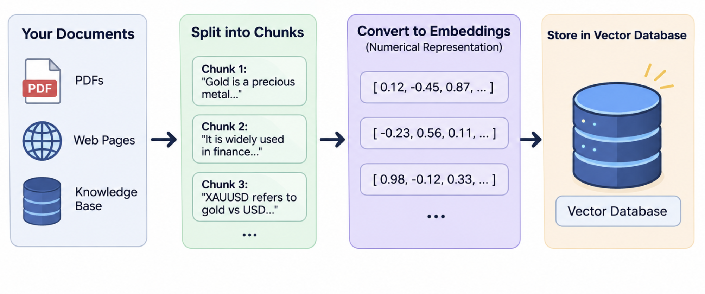
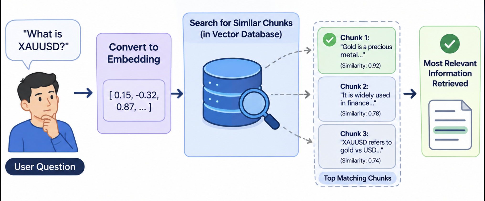

RAG stands for Retrieval-Augmented Generation. It’s a technique that makes a language model’s answers more accurate by letting it look up relevant information before responding, instead of relying only on what it learned during training.

### How it works

1. **Index:** Your documents (PDFs, web pages, a knowledge base) are split into chunks and converted into embeddings, which are numerical representations of meaning. These are stored in a vector database.

2. **Retrieve:** When a user asks a question, the question is also converted into an embedding, and the system finds the chunks most similar in meaning.

3. **Augment:** Those retrieved chunks are added to the prompt alongside the question.

4. **Generate:** The model writes an answer grounded in that supplied text, often citing the sources.