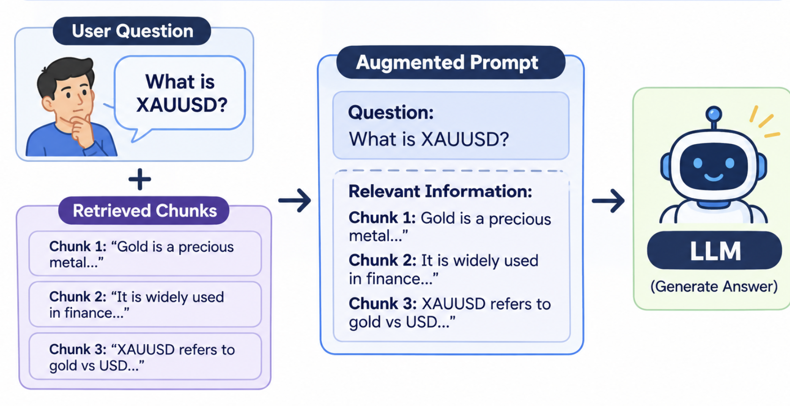
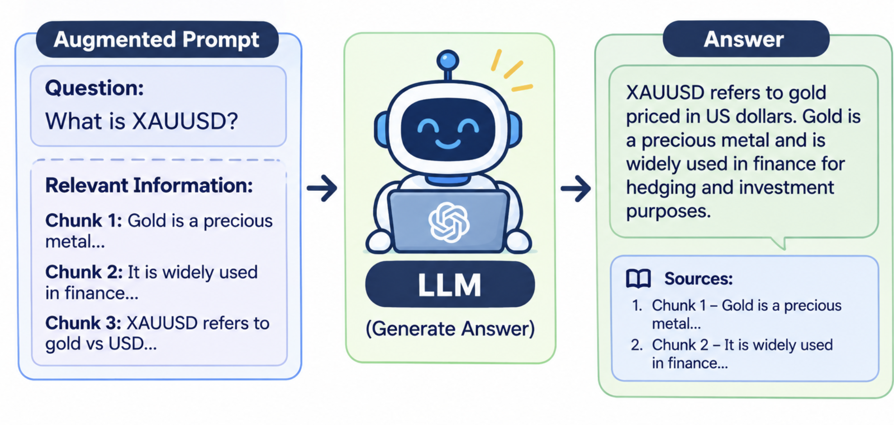

RAG stands for Retrieval-Augmented Generation. It’s a technique that makes a language model’s answers more accurate by letting it look up relevant information before responding, instead of relying only on what it learned during training.

### How it works

1. **Index:** Your documents (PDFs, web pages, a knowledge base) are split into chunks and converted into embeddings, which are numerical representations of meaning. These are stored in a vector database.


2. **Retrieve:** When a user asks a question, the question is also converted into an embedding, and the system finds the chunks most similar in meaning.


3. **Augment:** Those retrieved chunks are added to the prompt alongside the question.



4. **Generate:** The model writes an answer grounded in that supplied text, often citing the sources.



### Why RAG is Needed?

**The problem**

Claude and ChatGPT only know what they learned during training. They have never seen your company’s documents, so they can’t answer questions about them correctly. An example:

Suppose you ask ChatGPT: “What is the return policy of my shop, ShopEasy?”

ChatGPT has never read ShopEasy’s policy. It will either say “I don’t know” or, worse, make up an answer like “14 days”. That answer sounds confident but is wrong.

The fix: Give the LLM your policy text along with the question, like handing a student the right textbook page before an exam question:

```
“Here is our policy: Items can be returned within 30 days. Now answer: can I return after two weeks?”
```

Now it answers correctly, because the facts are right in front of it.

**So why do we need RAG?**
- Giving the LLM the right text is easy if you have one small document: you just paste it in.
- But a real company has thousands of documents. You can’t paste all of them into every question, because it’s too big, too slow, and too expensive.
- So RAG does this automatically:
  1. It searches your documents for only the few pieces relevant to the question.
  2. It attaches just those pieces to the question.
  3. The LLM reads them and answers correctly.

